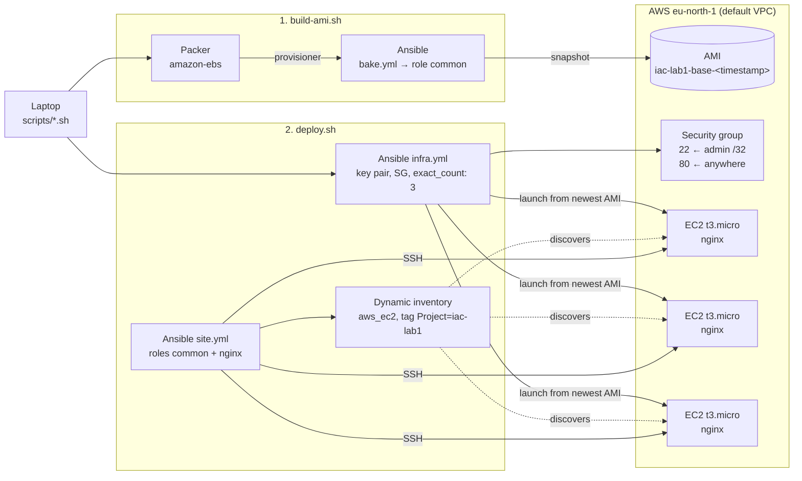

# ICA0024 Lab 1: Packer + Ansible on AWS

Three Ubuntu 24.04 web servers in AWS `eu-north-1`. Packer builds one hardened
base image, and Ansible creates the AWS resources and configures the servers.
Each server serves a page showing its own hostname, instance ID and AZ.

## Architecture



Two layers, both in Ansible:

| Layer | File | Runs on | Does |
|---|---|---|---|
| Image | `packer/base.pkr.hcl` → `ansible/bake.yml` | temporary build instance | apt upgrade, base packages, timezone, SSH hardening, ufw |
| Infra | `ansible/infra.yml` | localhost → AWS API | SSH key, security group, exactly 3 instances |
| Config | `ansible/site.yml` | the 3 servers | `common` again (patches + drift), `nginx`, HTTP check |
| Teardown | `ansible/destroy.yml` | localhost → AWS API | terminate instances, delete SG and key (and optionally the AMIs) |

## Prerequisites

- **AWS credentials** for the TalTech account as an AWS CLI profile, then
  `export AWS_PROFILE=<your-profile>` (Packer and Ansible both read it):
  - access key + secret: `aws configure --profile <your-profile>`
  - portal / start URL: `aws configure sso`, then `aws sso login --profile <your-profile>`
    at the start of each session
  - check with `aws sts get-caller-identity`. If that fails, nothing else will work.
- **SSH key** `~/.ssh/id_ed25519` (create one with `ssh-keygen -t ed25519` if missing).
- **Packer** ≥ 1.9: `brew tap hashicorp/tap && brew install hashicorp/tap/packer`
- **Ansible** with `boto3`/`botocore` in Ansible's own Python. Homebrew's
  `ansible` already includes them; with a pip install, run `pip install boto3 botocore`
  in the same environment.
- Collections:
  ```sh
  ansible-galaxy collection install -r ansible/requirements.yml
  ```

## Usage

```sh
./scripts/build-ami.sh   # ~10 min: bake the AMI
./scripts/deploy.sh      # create/update the 3 servers and configure them
./scripts/destroy.sh     # remove instances, SG and key pair
./scripts/destroy.sh -e purge_amis=true   # ...and the AMIs + snapshots
```

`deploy.sh` ends by fetching `http://<ip>/` from each server and checking that the
page contains that server's hostname, then prints the URLs.

Handy checks:

```sh
cd ansible
ansible-inventory --graph              # what the dynamic inventory sees
ansible role_web -m ping
curl http://<public-ip>/
ssh ubuntu@<public-ip>                 # uses ~/.ssh/id_ed25519
```

## Design notes

- **Idempotent.** Running `deploy.sh` again reports almost nothing as changed
  (only things like package updates released since the last run). `exact_count: 3`
  counts instances by tag: if one is terminated by hand, the next run launches one
  replacement; if `instance_count` changes in `group_vars/all.yml`, the fleet
  grows or shrinks to match.
- **No hard-coded IPs.** The `aws_ec2` inventory plugin finds running instances
  tagged `Project=iac-lab1` and groups them by their `Role` tag (`role_web`).
- **Same role at bake time and deploy time.** `common` is frozen into the AMI, so new
  servers boot already patched. It also runs on every deploy to apply later updates and undo drift.
- **SSH key stays local.** `infra.yml` imports the public half of
  `~/.ssh/id_ed25519` as the `iac-lab1` key pair; the private key never leaves the
  laptop. Change `key_path` in `group_vars/all.yml` to use a different key.
- **Locked down.** SSH only from the deployer's current IP (`deploy.sh`
  detects it), key-only auth, no root login, ufw allowing just 22/80, IMDSv2
  required, nginx version hidden.
- **New AMI → new servers.** Existing instances are not replaced when a new AMI
  is built. To roll them, run `destroy.sh` then `deploy.sh`. That full cycle also
  proves the stack can be rebuilt from scratch.

## Layout

```
LAB1/
├── packer/
│   ├── base.pkr.hcl          # amazon-ebs source + ansible provisioner
│   └── variables.pkr.hcl
├── ansible/
│   ├── ansible.cfg
│   ├── inventory/aws_ec2.yml # dynamic inventory
│   ├── group_vars/all.yml    # region, instance type/count, names
│   ├── requirements.yml
│   ├── bake.yml              # Packer → role common
│   ├── infra.yml             # key, SG, 3× EC2
│   ├── site.yml              # roles common + nginx, HTTP check
│   ├── destroy.yml
│   └── roles/
│       ├── common/           # apt upgrade, packages, timezone, SSH, ufw
│       └── nginx/            # nginx + templated index page
└── scripts/
    ├── build-ami.sh
    ├── deploy.sh
    └── destroy.sh
```
