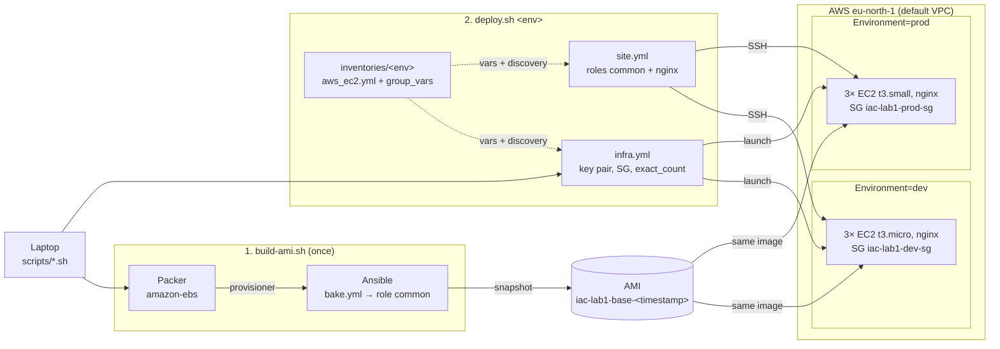

# ICA0024 Lab 1: Packer + Ansible on AWS

Ubuntu 24.04 web servers in AWS `eu-north-1`, in two environments (dev and
prod). Packer builds one hardened base image, and Ansible creates the AWS
resources and configures the servers. Each server serves a page showing its
environment, hostname, instance ID and AZ.

## Architecture



| Layer | File | Runs on | Does |
|---|---|---|---|
| Image | `packer/base.pkr.hcl` → `ansible/bake.yml` | temporary build instance | apt upgrade, base packages, timezone, SSH hardening, ufw |
| Infra | `ansible/infra.yml` | localhost → AWS API | SSH key, security group, exactly N instances for one environment |
| Config | `ansible/site.yml` | that environment's servers | `common` again (patches + drift), `nginx`, HTTP check |
| Teardown | `ansible/destroy.yml` | localhost → AWS API | terminate one environment's instances, delete its SG and key (optionally the AMI) |

## Environments

dev and prod run the same playbooks, roles and AMI. They differ only in their
inventory directory:

| | `inventories/dev/` | `inventories/prod/` |
|---|---|---|
| `aws_ec2.yml` | finds instances tagged `Environment=dev` | `Environment=prod` |
| `group_vars/all.yml` | `t3.micro` × 3 | `t3.small` × 3 |

Every AWS resource name includes the environment (`iac-lab1-dev-sg`,
`iac-lab1-prod-sg`, ...) and every resource is tagged `Environment`, so deploying
or destroying one environment never touches the other.

Shared settings stay in `ansible/group_vars/all.yml`. Per-environment values
must **not** be set there as well: playbook-level `group_vars` take precedence
over inventory `group_vars`, so a value there would silently override the
environment's. Adding a third environment is a copy of `inventories/dev/`
with two values changed.

## Prerequisites

- **AWS credentials** for the TalTech account as an AWS CLI profile, then
  `export AWS_PROFILE=<your-profile>` (Packer and Ansible both read it):
  - access key + secret: `aws configure --profile <your-profile>`
  - portal / start URL: `aws configure sso`, then `aws sso login --profile <your-profile>`
    at the start of each session
  - check with `aws sts get-caller-identity`. If that fails, nothing else will work.
- **Linux or macOS shell.** Ansible can't run natively on Windows, so use WSL there.
- **SSH key** `~/.ssh/id_ed25519` (create one with `ssh-keygen -t ed25519` if missing).
- **AWS CLI v2**: [install guide](https://docs.aws.amazon.com/cli/latest/userguide/getting-started-install.html)
- **Packer** ≥ 1.9: [install guide](https://developer.hashicorp.com/packer/install)
  (HashiCorp's apt/dnf repository, a zip download, or a package manager)
- **Ansible** with `boto3` and `botocore` in the same Python environment, e.g.:
  ```sh
  pipx install --include-deps ansible
  pipx inject ansible boto3 botocore
  ```
  or `python3 -m pip install --user ansible boto3 botocore`.
- Collections:
  ```sh
  ansible-galaxy collection install -r ansible/requirements.yml
  ```

## Usage

```sh
./scripts/build-ami.sh        # ~5 min: bake the AMI (shared by all environments)
./scripts/deploy.sh dev       # create/update dev and configure it
./scripts/deploy.sh prod      # same for prod
./scripts/destroy.sh dev      # remove dev only; prod keeps running
./scripts/destroy.sh prod -e purge_amis=true   # ...and the AMI, once no environment uses it
```

`deploy.sh` ends by fetching `http://<ip>/` from each server and checking that the
page contains that server's hostname, then prints the URLs.

Handy checks:

```sh
cd ansible
ansible-inventory -i inventories/dev --graph    # what the dynamic inventory sees
ansible -i inventories/dev role_web -m ping
curl http://<public-ip>/
ssh ubuntu@<public-ip>                          # uses ~/.ssh/id_ed25519
```

## Design notes

- **Idempotent.** Running `deploy.sh` again reports almost nothing as changed
  (only things like package updates released since the last run). `exact_count`
  counts the instances of one project and environment by tag: if one is
  terminated by hand, the next run launches one replacement; if
  `instance_count` changes, the fleet grows or shrinks to match.
- **No hard-coded IPs.** The `aws_ec2` inventory plugin finds running instances
  by their `Project` and `Environment` tags and groups them by their `Role`
  tag (`role_web`).
- **No default environment.** `ansible.cfg` sets no inventory, the scripts
  require `dev` or `prod`, and the playbooks refuse to run without one.
- **One image, promoted.** Packer builds the AMI once, and dev and prod both
  launch from the newest one. The AMI can only be purged once no environment has
  servers left.
- **Same role at bake time and deploy time.** `common` is frozen into the AMI, so new
  servers boot already patched. It also runs on every deploy to apply later updates and undo drift.
- **SSH key stays local.** `infra.yml` imports the public half of
  `~/.ssh/id_ed25519` as the `iac-lab1-<env>` key pair; the private key never
  leaves the laptop. Change `key_path` in `group_vars/all.yml` to use a different key.
- **Locked down.** SSH only from the deployer's current IP (`deploy.sh`
  detects it), key-only auth, no root login, ufw allowing just 22/80, IMDSv2
  required, nginx version hidden.
- **New AMI → new servers.** Existing instances are not replaced when a new AMI
  is built. To roll an environment, run `destroy.sh <env>` then `deploy.sh <env>`.
  That full cycle also proves the stack can be rebuilt from scratch.

## Layout

```
LAB1/
├── packer/
│   ├── base.pkr.hcl              # amazon-ebs source + ansible provisioner
│   └── variables.pkr.hcl
├── ansible/
│   ├── ansible.cfg
│   ├── inventories/
│   │   ├── dev/
│   │   │   ├── aws_ec2.yml       # dynamic inventory, Environment=dev
│   │   │   └── group_vars/all.yml  # instance type/count for dev
│   │   └── prod/
│   │       ├── aws_ec2.yml
│   │       └── group_vars/all.yml
│   ├── group_vars/all.yml        # shared: region, names, AMI prefix
│   ├── requirements.yml
│   ├── bake.yml                  # Packer → role common
│   ├── infra.yml                 # key, SG, N× EC2 for one environment
│   ├── site.yml                  # roles common + nginx, HTTP check
│   ├── destroy.yml
│   └── roles/
│       ├── common/               # apt upgrade, packages, timezone, SSH, ufw
│       └── nginx/                # nginx + templated index page
└── scripts/
    ├── build-ami.sh
    ├── deploy.sh                 # deploy.sh dev|prod
    └── destroy.sh                # destroy.sh dev|prod
```
