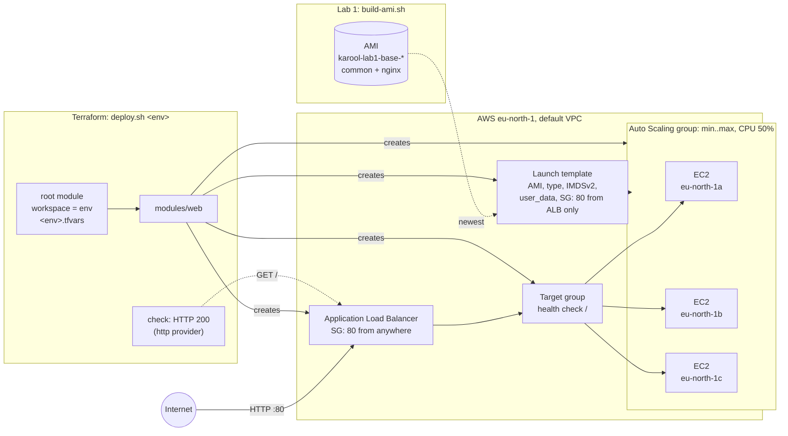

# ICA0024 Lab 2: Terraform auto-scaling web tier on AWS

An Application Load Balancer in front of an auto-scaling group of web servers
in AWS `eu-north-1`, written in Terraform. The servers launch from the AMI built
in [Lab 1](../LAB1) (Packer + Ansible: hardened Ubuntu 24.04 with nginx baked
in), so they boot ready to serve. There are two environments, dev and prod,
which differ only in a `.tfvars` file.

## Architecture



| Resource | Purpose |
|---|---|
| `aws_lb` + `aws_lb_listener` | Public entry point on port 80, spread over all 3 AZs |
| `aws_lb_target_group` | Health-checks `/` on each server and routes only to healthy ones |
| `aws_launch_template` | What every server looks like: Lab 1 AMI, instance type, security group, IMDSv2, user_data |
| `aws_autoscaling_group` | Keeps between `min_size` and `max_size` servers running across the AZs, replaces unhealthy ones, rolls out changes |
| `aws_autoscaling_policy` | Target tracking: adds or removes servers to keep average CPU around 50% |
| 2 × `aws_security_group` | Load balancer: 80 from anywhere. Servers: 80 from the load balancer only, no SSH. |
| `check "site_up"` | After every plan/apply, fetches the page through the load balancer (http provider) |

## Environments

| | `dev.tfvars` | `prod.tfvars` |
|---|---|---|
| Instance type | `t3.micro` | `t3.small` |
| Servers (min–max) | 2–4 | 3–6 |

Each environment is a Terraform **workspace**, so each has its own state file
(`terraform.tfstate.d/<env>/`). The workspace name becomes part of every
resource name (`karool-lab2-dev-alb`) and the `Environment` tag. Code, module and
AMI are identical. Applying in the `default` workspace is refused.

## Prerequisites

- **Linux or macOS shell** (on Windows, use WSL).
- **Terraform** ≥ 1.6: [install guide](https://developer.hashicorp.com/terraform/install)
- **AWS credentials**, the same as Lab 1: `export AWS_PROFILE=<your-profile>`
  (run `aws sso login --profile <your-profile>` first if you use SSO), then check with
  `aws sts get-caller-identity`.
- **The Lab 1 AMI** must exist: run `../LAB1/scripts/build-ami.sh` once.

## Usage

```sh
./scripts/deploy.sh dev       # shows the plan, asks "yes", creates/updates dev
./scripts/deploy.sh prod
./scripts/destroy.sh dev      # removes dev only; prod keeps running
```

Add `-auto-approve` to skip the confirmation. A first deploy takes about 3–4
minutes, most of it waiting for the load balancer and for the servers to pass
health checks. It ends by printing the `url` output.

See the load balancer at work: each request can land on a different server.

```sh
url=$(terraform -chdir=terraform output -raw url)
for i in $(seq 6); do curl -s "$url" | grep -oE 'i-[0-9a-f]+|eu-north-1[a-c]' | paste -sd' ' -; done
```

## Design notes

- **Immutable servers.** Everything is baked into the AMI, so there's no Ansible
  run and no SSH after launch. user_data only writes a page naming the instance,
  read from the metadata service. A broken server isn't fixed in place: the
  auto-scaling group replaces it.
- **Self-healing.** `health_check_type = "ELB"` means a server that fails the
  load balancer's health check is terminated and replaced automatically.
- **Rolling updates.** Build a new AMI in Lab 1 (or change `instance_type`) and
  run `deploy.sh` again. Terraform creates a new launch template version, and
  `instance_refresh` replaces the servers a few at a time, keeping at least 50%
  in service, with no downtime.
- **Scaling isn't undone by Terraform.** `desired_capacity` isn't set in code: it
  starts at `min_size` and the CPU policy moves it. Re-running `deploy.sh`
  therefore doesn't reset a scaled-out group.
- **High availability.** The load balancer and the servers span all 3 AZs of
  the region (the default VPC's subnets).
- **Least access.** Servers accept port 80 only from the load balancer's security
  group, have no key pair and no SSH, and require IMDSv2.
- **Safe in a shared account.** The TalTech AWS account is shared with other
  students. Terraform only changes or deletes resources recorded in its own
  state, which are all named `karool-lab2-<env>-*`. The AMI lookup filters on both the
  name `karool-lab1-base-*` and the tag `Project=karool-lab1`, so it can't pick up
  another student's image.
- **Lightweight on purpose.**
  - The default VPC avoids network code and NAT gateway costs, at the price of
    public subnets. The servers have public IPs for outbound updates but accept
    nothing except load balancer traffic.
  - State is local. For a team you'd use an S3 backend with locking.
  - There's no HTTPS, because that needs a domain and an ACM certificate.

## Layout

```
LAB2/
├── terraform/
│   ├── versions.tf           # Terraform + provider versions (aws, http)
│   ├── main.tf               # provider, default VPC/subnets, Lab 1 AMI, module call
│   ├── variables.tf
│   ├── outputs.tf            # url, asg_name, ami_id
│   ├── checks.tf             # post-deploy HTTP check
│   ├── dev.tfvars            # the only difference between environments
│   ├── prod.tfvars
│   └── modules/web/
│       ├── main.tf           # SGs, launch template, ASG, scaling policy, ALB
│       ├── variables.tf
│       ├── outputs.tf
│       └── user_data.sh.tftpl
└── scripts/
    ├── deploy.sh             # deploy.sh dev|prod
    └── destroy.sh            # destroy.sh dev|prod
```
