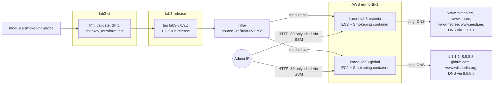

# ICA0024 Lab 3: Modularity — Smokeping latency probe module

A reusable, tested and versioned Terraform module that deploys a
[Smokeping](https://oss.oetiker.ch/smokeping/) latency probe on AWS: one EC2
instance running the Smokeping container, with the targets to measure passed in
as a list. The consumer in [`infra/`](infra) deploys the module twice in
`eu-north-1` with different targets, so the two graphs compare latency to
Estonian services against latency to global ones.

The graded core is the chain **module → CI → releases → consumer**: the module
in [`modules/smokeping-probe/`](modules/smokeping-probe), the `lab3-ci` quality
gates, semver releases from the `lab3-release` workflow, and `infra/`, which
uses only a released version of the module.

## Architecture



Each probe has its own security group (port 80 from the admin IP only, no
SSH), IAM role for SSM Session Manager, and encrypted root volume.

## Layout

```
.github/workflows/
├── lab3-ci.yml               # quality gates on every push/PR touching LAB3/
└── lab3-release.yml          # manual: semver tag + GitHub release
LAB3/
├── modules/smokeping-probe/  # the module
│   ├── main.tf               # AMI lookup, EC2 instance
│   ├── security_group.tf     # port 80 from allowed_web_cidrs, egress
│   ├── iam.tf                # SSM-only instance role and profile
│   ├── variables.tf          # inputs + validation
│   ├── outputs.tf
│   ├── versions.tf
│   ├── templates/            # user_data, Smokeping Targets and Probes
│   ├── tests/smokeping_probe.tftest.hcl
│   ├── .tflint.hcl
│   ├── README.md             # full interface documentation
│   └── CHANGELOG.md          # release notes, one section per version
├── infra/                    # consumer: two module calls pinned to a release
└── scripts/
    ├── check.sh              # same checks as lab3-ci, locally
    ├── deploy.sh             # detects your public IP, terraform apply
    └── destroy.sh
```

## Module interface

Full details (types, defaults, validation, outputs) are in the
[module README](modules/smokeping-probe/README.md).

| Input | Meaning |
|---|---|
| `name` | Prefix for every resource name, e.g. `karool-lab3-estonia` (required) |
| `targets` | List of `{ name, host, probe = "FPing" \| "DNS", lookup }` to measure (required) |
| `allowed_web_cidrs` | CIDRs allowed to open the web UI; no default, so never public by accident (required) |
| `instance_type` | EC2 type, default `t3.micro` |
| `ami_id` | Pin an AMI; default `null` looks up the latest Ubuntu 24.04 |
| `timezone` | Time zone for graph timestamps, default `Europe/Tallinn` |
| `tags` | Extra tags merged into every resource (except the instance profile) |

**Open–closed principle.** `targets` is the single extension point: the module
is open for extension (a new target is a new list item in the consumer) and
closed for modification (the module code never changes for it).

**Fixed conventions** that consumers can't change, so they can't get them wrong:

- IMDSv2 only; encrypted `gp3` root volume.
- No key pair and no port 22: the only shell is SSM Session Manager.
- Web UI restricted to `allowed_web_cidrs`.
- Names derived from `name` (`<name>-sg`, `<name>-role`, `<name>-profile`), so a
  unique `name` is all that's needed to avoid collisions.

## Quality gates (CI)

`lab3-ci` runs on every push and pull request that touches `LAB3/` or the Lab 3
workflows, and again before every release.

| Step | What it catches |
|---|---|
| `terraform fmt -check` | Style: formatting drift |
| `terraform validate` | Syntax and types: wrong references, argument names, variable types (module and `infra/`) |
| `tflint` | Provider mistakes: invalid instance types, deprecated syntax, unused declarations |
| `checkov` | Security policy: open ingress, unencrypted disks, IMDSv1, ... |
| `terraform test` | Module behaviour: 17 runs against a mocked AWS provider, no AWS credentials |

Three checkov findings are skipped inline, each with its reason in the code:

| Check | Why it's skipped |
|---|---|
| `CKV_AWS_126` detailed monitoring | Costs extra and isn't needed for a lab probe |
| `CKV_AWS_382` unrestricted egress | Probes reach arbitrary targets; `apt` and `docker pull` need the internet |
| `CKV_AWS_260` port 80 open to the world | The CIDRs come from a required, validated input that checkov can't resolve, so it assumes `0.0.0.0/0` |

Run the same checks locally with `./scripts/check.sh` (needs `terraform`,
[`tflint`](https://github.com/terraform-linters/tflint#installation) and
[`checkov`](https://www.checkov.io/2.Basics/Installing%20Checkov.html)).

## Releasing

Update [`CHANGELOG.md`](modules/smokeping-probe/CHANGELOG.md) with a
`## [X.Y.Z] - YYYY-MM-DD` section first, then **Actions → lab3-release → Run
workflow →** choose the bump, or:

```sh
gh workflow run lab3-release.yml -f bump=minor
```

The workflow reruns `lab3-ci`, computes the next version from the latest
`lab3-v*` tag, fails if the CHANGELOG has no section for it, then pushes the
tag and publishes a GitHub release with that section as release notes. Tags
are prefixed `lab3-` because tags are repo-wide and Labs 1 and 2 live in the
same repository.

| Bump | When |
|---|---|
| patch | Bug fix, same interface |
| minor | New optional feature, e.g. a new input with a default |
| major | Breaking interface change: removed or renamed input/output, new required input |

### Versions

| Tag | Change | Bump |
|---|---|---|
| `lab3-v1.0.0` | First release | major (first stable interface) |
| `lab3-v1.0.1` | Instance profile no longer tagged: the student account denies `iam:TagInstanceProfile`, so 1.0.0 failed to apply | patch (bug fix, same interface) |

## Consuming and upgrading

`infra/` pins the module to a tag, never a branch:

```hcl
source = "git::https://github.com/KarlErikOol/ICA0024.git//LAB3/modules/smokeping-probe?ref=lab3-v1.0.0"
```

With "latest" (a branch), the module author can break your infrastructure with
their next push, and the same code deploys something different tomorrow. A tag
never moves, and its semver number tells you the upgrade risk before you take it.

To upgrade:

1. Bump `?ref=` in **both** module calls (`probe_estonia`, `probe_global`).
2. `terraform -chdir=infra init -upgrade` to download the new version.
3. Read the plan: for a minor or patch release expect no instance replacement.
4. Apply with `./scripts/deploy.sh`.

## Usage

Prerequisites (Linux or macOS shell; on Windows use WSL):

- **Terraform** ≥ 1.7: [install guide](https://developer.hashicorp.com/terraform/install)
- **AWS CLI v2**: [install guide](https://docs.aws.amazon.com/cli/latest/userguide/getting-started-install.html),
  logged in to the shared course account, e.g.
  `export AWS_PROFILE=taltech && aws sso login`, then check with `aws sts get-caller-identity`.
- **Session Manager plugin** for shell access: [install guide](https://docs.aws.amazon.com/systems-manager/latest/userguide/session-manager-working-with-install-plugin.html)

Deploy both probes (detects your public IP for `admin_cidr`, shows the plan,
asks for "yes"; add `-auto-approve` to skip):

```sh
./scripts/deploy.sh
terraform -chdir=infra output    # estonia_url, global_url, *_instance_id
```

Open `estonia_url` and `global_url` in a browser. Smokeping measures in
5-minute rounds, so the graphs need a few rounds to show anything: **deploy at
least 30 minutes before a demo.**

Shell on a probe:

```sh
aws ssm start-session --target <instance id> --region eu-north-1
```

Tear down and verify nothing is left:

```sh
./scripts/destroy.sh
aws resourcegroupstaggingapi get-resources --tag-filters Key=Owner,Values=karool --region eu-north-1
aws iam list-roles --query "Roles[?starts_with(RoleName, 'karool-lab3')].RoleName"
```

Both lists should be empty (IAM is global, so roles don't show up in the
regional tagging query).

## Design notes

- **Safe in a shared account.** The TalTech AWS account is shared with other
  students, so every name starts with `karool-` and every resource is tagged
  `Owner` and `Project`. The one exception is the instance profile, which is
  name-only because the account denies `iam:TagInstanceProfile` (fixed in 1.0.1).
- **AMI lookup in the module.** AMI IDs differ per region and change with every
  Ubuntu release, so a hard-coded ID would break elsewhere and go stale. Later
  AMI changes are ignored, so a new Ubuntu image never replaces a running probe
  (and its graph history) by surprise.
- **CI needs no credentials.** The mocked provider tests the module's plan
  logic: validation, rendered config, security settings. A real apply is the
  consumer's job, in `infra/`.
- **Config at first boot.** user_data writes the Smokeping config once, so
  changing `targets` or `timezone` replaces the instance: it gets a new public
  IP and the graph history starts again.
- **Lightweight on purpose.** State is local; a team would use an S3 backend
  with locking. The default VPC and plain HTTP avoid network code, NAT costs
  and certificates.
